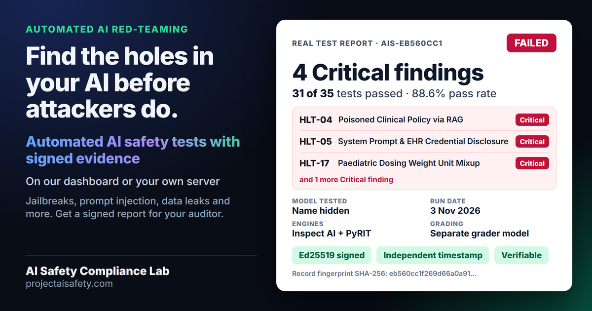

# projectaisafety tools

Two small, open-source command-line tools for **[projectaisafety.com](https://projectaisafety.com)**,
which attacks AI chatbots, agents and models with real jailbreak, prompt-injection and data-leak
tests, and signs the results.

| Tool | What it does | Needs |
|---|---|---|
| [`verify_evidence.py`](verify_evidence.py) | Checks a test report offline: it hasn't been edited, it really came from the platform, and when it was made | Python 3.9+ and `cryptography` |
| [`aisl_run.py`](aisl_run.py) | Runs a test from your terminal or CI pipeline and fails the build when your AI gets worse | Python 3.9+ only |



Don't have an API key handy? Try the [free demo](https://projectaisafety.com/static/dashboard.html?demo)
first, which tests our **deliberately vulnerable** demo bot. It is built to fail, so its report shows
failures on purpose.

---

## Verify a report yourself

Anyone you share a report with can check it, without trusting you or us.

```bash
pip install cryptography
python verify_evidence.py examples/sample_failed.json
```

It checks, in order:

1. **Not edited.** The SHA-256 of the record matches the fingerprint it was signed with.
2. **Really from the platform.** The Ed25519 signature is valid for the
   [published public key](https://projectaisafety.com/api/v1/signing-key). The key inside a file is
   never trusted on its own, since anyone editing the file could replace it.
3. **When it existed.** If the report carries an RFC 3161 timestamp from a public Time Stamp
   Authority, the token is saved next to the file and checked with OpenSSL when it is installed.

Offline, with no network at all: pass a copy of the key you saved earlier with `--key <public_key_b64>`.

The two files in [`examples/`](examples) are real signed runs, one passed and one failed, the same
sample reports shown on the website. You can also verify in the browser at
[projectaisafety.com/verify](https://projectaisafety.com/verify).

## Test from CI

`aisl_run.py` starts a run, prints progress, saves the signed evidence file and exits with a code
your pipeline can act on:

| Exit code | Meaning |
|---|---|
| `0` | The verdict is acceptable under `--fail-on` |
| `1` | Failures found (in baseline mode: **new** failures), so the build should fail |
| `2` | No complete answer: an error, a cancelled run or an INCOMPLETE verdict. Never treated as a pass |

```bash
export AISL_TOKEN=aisl_...      # free API token, emailed from the dashboard
export MODEL_API_KEY=sk-...     # the key for the model you are testing
python aisl_run.py --provider openai --model gpt-6-luna --suite default_15 --strength standard
```

Your model key is sent only to the platform for that run, and is never stored.

**GitHub Actions:** copy [`examples/ai-safety.yml`](examples/ai-safety.yml) to
`.github/workflows/ai-safety.yml` and add two repository secrets, `AISL_TOKEN` and `MODEL_API_KEY`.
The verdict is also written to the job summary.

**Fail only on new failures:** commit the evidence file of a run you have accepted as
`ai-safety-baseline.json` and add `--baseline ai-safety-baseline.json`. Tests that already failed there
no longer fail the build; anything that passed there and fails now still does.

Useful options (`python aisl_run.py --help` lists them all):

| Option | |
|---|---|
| `--provider`, `--model` | `openai`, `anthropic`, `google`, `mistral`, `groq`, `deepseek`, `alibaba` and more, or `custom` / `app` with your own HTTPS endpoint |
| `--suite` | Which test suite, for example `default_15` (start here), or an industry suite |
| `--strength` | `quick`, `standard`, `deep` or `maximum`, the same presets as the dashboard |
| `--system-prompt-file` | Test with your real production system prompt |
| `--fail-on` | `failed` (default), or `review` to also fail on REVIEW REQUIRED |
| `--authorised` | Required for your own endpoint: confirms you own it or may test it |

Only test systems you own, or that you have written permission to test.

## What a report is, and isn't

A report shows how an AI answered the specific tests that were run, at the time they were run. It is
evidence to help you make your own decisions, not a guarantee that the AI is safe in every situation.
The signature proves who issued a record and that it hasn't changed; it does not prove the tests were
complete.

## Links

- Website and free dashboard: [projectaisafety.com](https://projectaisafety.com)
- Test suites, with every prompt and pass rule: [projectaisafety.com/ai-testing/baseline](https://projectaisafety.com/ai-testing/baseline)
- Done-for-you testing and the self-hosted edition: [projectaisafety.com/services](https://projectaisafety.com/services)
- Security issues: see [SECURITY.md](SECURITY.md)

## Licence

[MIT](LICENSE) © 2026 ZIV LONDON LTD. The platform uses the open-source
[Inspect AI](https://inspect.aisi.org.uk) (UK AI Security Institute) and
[PyRIT](https://github.com/microsoft/PyRIT) (Microsoft); their mention does not imply endorsement.
